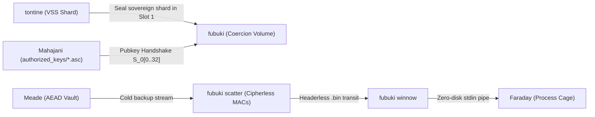

# Fubuki (`fubuki` v0.2.0)

[](https://github.com/tsiscoe/Fubuki/actions/workflows/ci.yml)
[](LICENSE)
[](Cargo.toml)
[![Safety: #![forbid(unsafe_code)]](https://img.shields.io/badge/unsafe-forbid-success.svg)](src/lib.rs)

**Fubuki** (`fubuki`) is a pure-Rust (`#![forbid(unsafe_code)]`, Rust 2024 Edition) **Cipherless Keyed-BLAKE3 Winnowing & Elligator2 Coercion-Resistant Dual Volume Engine** featuring a **`Mahajani`-style Asymmetric Pubkey Handshake Authentication Modality** alongside traditional passphrases.

Standard authenticated encryption formats (`age`, OpenPGP, OpenSSL `Salted__`, LUKS) announce their own existence with magic headers, version integers, or key-slot metadata. Even when ciphertext is computationally indistinguishable from random noise, header framing convicts a payload under strict cipher-export inspection or coercive ("rubber-hose") threat models. `fubuki` eliminates structural indictment through two headerless primitives:

1. **Mode A — Cipherless Packet Winnowing (`scatter` / `winnow`):** Implements Ronald Rivest's *Chaffing and Winnowing* paradigm using **zero encryption primitives**. Secrets are split into PKCS#7-padded 16-byte frames authenticated with domain-separated keyed BLAKE3 (`fubuki.wheat.v1` / `fubuki.wheat.eos.v1`), interleaved with CSPRNG chaff tuples, sequence-blinded per physical slot index, and filtered in constant time (`subtle::ConstantTimeEq`).
2. **Mode B — Elligator2 Headerless Coercion Volumes (`init-volume` / `seal` / `unlock`):** Fixed-stride `64 + B * 4096`-byte containers initialized entirely with OS CSPRNG entropy and prefixed with a two-branch uniform Curve25519 `Elligator2` representative ($S_0 = \mathcal{E}^{-1}(R) \parallel \text{Salt}_{256}$). A single branchless `Argon2id` + keyed BLAKE3 anchor locator maps duress and sovereign credentials into disjoint 4 KiB block spans (`[0, B_decoy)` vs `[B_decoy, B)`), while `fubuki unlock` executes identical verification paths regardless of credential class.
3. **Three Authentication Modalities (`Passphrase` / `Mahajani` Pubkey Handshake / Hybrid):**
   - **Passphrase:** Standard memorized secret stretched via `Argon2id`.
   - **Pubkey Handshake (`fubuki-hs-v1:<64hex>`):** Zero-password `Mahajani`-style challenge-response over OpenPGP `.asc` keys (`./authorized_keys/<user>.asc`) and `S_0[0..32]` `Elligator2` representatives—never storing public keys on disk inside the volume and never placing private keys on the host.
   - **Hybrid (`<passphrase>+fubuki-hs-v1:<64hex>`):** Two-factor combination binding both knowledge and asymmetric handshake.
4. **Forensic Indistinguishability Auditor (`audit-entropy`) & 3-Pane `ratatui` TUI (`tui`):** Measures Shannon entropy $H(X)$, Pearson $\chi^2$ $p$-value against $U(0,255)$, lag-1 serial byte correlation, Elligator2 top-bit balance, and magic-byte signature absence—while `fubuki tui` displays the Hundi Challenge and only the unlocked slot's logical span without ever exposing unallocated slack boundaries.



## Quick Start

```bash
# 1. Build
cargo build --release

# 2. Mode A: Cipherless winnowing stream (prompts out-of-band via TTY if FUBUKI_MAC_KEY is unset)
echo "API_TOKEN=example" | ./target/release/fubuki scatter --ratio 7 --out telemetry_dump.bin
./target/release/fubuki winnow --in telemetry_dump.bin

# 3. Mode B (Passphrase Modality): Provision & seal dual-trajectory coercion volume
./target/release/fubuki init-volume --size 64M --out ./calib_sensor_raw.dat --decoy-max 16M
./target/release/fubuki seal ./calib_sensor_raw.dat --in ./benign_notes.tar.zst --decoy-mode
./target/release/fubuki seal ./calib_sensor_raw.dat --in ./sovereign_shard.bin
./target/release/fubuki unlock ./calib_sensor_raw.dat --out -

# 4. Mode B (Mahajani Pubkey Handshake Modality — Zero Password / Hybrid)
./target/release/fubuki keygen --user alice --out-dir ./authorized_keys
# (Or fetch an armored key from an HTTPS HKP keyserver cleanly into ./authorized_keys:)
python tools/fetch_keyserver.py alice -d ./authorized_keys

# One-shot compound dual-pubkey sealing (ephemeral key stays strictly in RAM and zeroizes):
./target/release/fubuki init-volume --size 64M --out ./calib_sensor_raw.dat --decoy-max 16M \
  --duress-pubkey alice_duress --duress-in ./benign_notes.tar.zst \
  --sov-pubkey alice --sov-in ./sovereign_shard.bin

# Or single-slot pubkey sealing + challenge-response unlock:
./target/release/fubuki seal ./calib_sensor_raw.dat --in ./sovereign_shard.bin --pubkey alice
./target/release/fubuki challenge ./calib_sensor_raw.dat
# Off-host key enclave computes handshake response (`fubuki-hs-v1:...` or `pin+fubuki-hs-v1:...`):
./target/release/fubuki handshake --challenge ./calib_sensor_raw.dat
./target/release/fubuki unlock ./calib_sensor_raw.dat --out -

# 5. Forensic uniformity audit & 3-pane TUI
./target/release/fubuki audit-entropy ./calib_sensor_raw.dat
./target/release/fubuki tui --target ./calib_sensor_raw.dat
```

## Verification

```bash
cargo fmt --all -- --check
cargo clippy --all-targets -- -D warnings
cargo test
```
